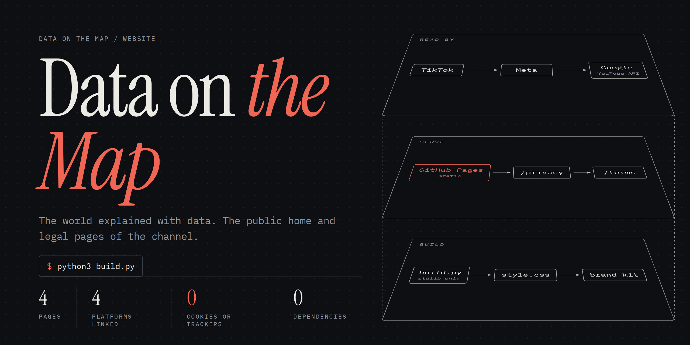
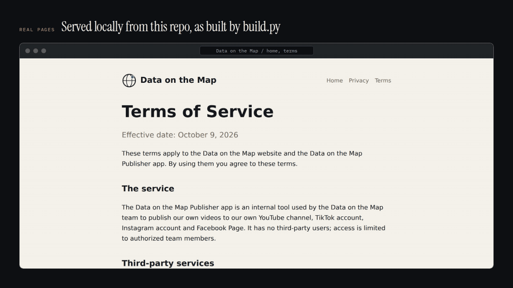
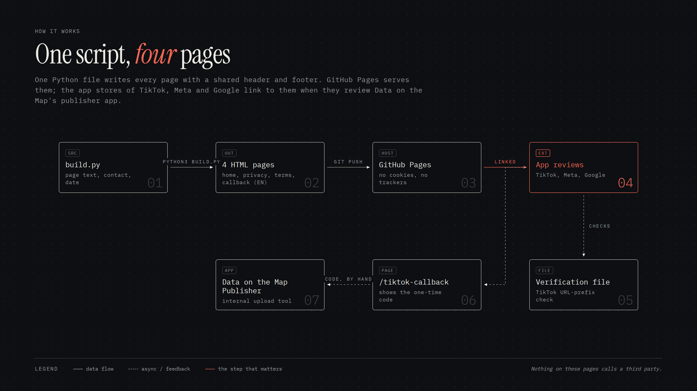

<p align="center"><a href="#demo"><picture>
  <source media="(prefers-color-scheme: light)" srcset="docs/images/banner-light.png">
  
</picture></a></p>

<p align="center"><b>The world explained with data. The public home and legal pages of the channel.</b><br>
<a href="#how-to-build">Install</a> · <a href="#demo">Demo</a> · <a href="#how-it-works">How it works</a> · <a href="build.py">Source</a></p>

<p align="center">
  
  
  
  
</p>

# Data on the Map: website

Public home, Privacy Policy and Terms of Service for the Data on the Map channel and its internal publisher app.
TikTok, Meta and Google point their app listings at these pages. Plain HTML/CSS: no cookies, no analytics, no trackers,
no third-party requests.

- Edit `build.py` (shared header and footer, page text, contact email), then run `python3 build.py`.
- `assets/app-icon-1024.png` is the 1024x1024 app icon (TikTok). `favicon.png` and `assets/logo-120.png` are made from
  brand logo A (`lagowski/dataonthemap-studio` `brand/avatar_light_1080.png`).
- `tiktok-callback/` only displays the one-time code TikTok returns; it sends nothing anywhere.
- No secret ever goes in this repo.

## How to build

```bash
python3 build.py                  # writes index.html, privacy/, terms/, tiktok-callback/
python3 -m http.server 8000       # preview at http://localhost:8000
```

## Demo

<p align="center"></p>

<sub>Real pages, served locally from this repo: the home page and the terms page.</sub>

## How it works

<p align="center"></p>

`build.py` writes the four pages with one shared header and footer. GitHub Pages serves them as plain files, and the
TikTok, Meta and Google app listings of the internal publisher app link to the privacy and terms pages. Nothing on the
pages calls a third party.
